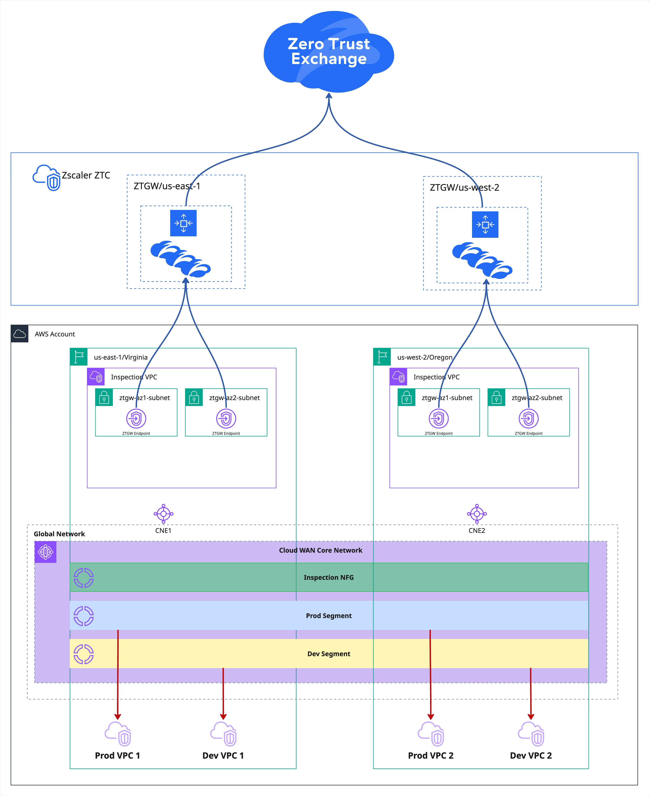
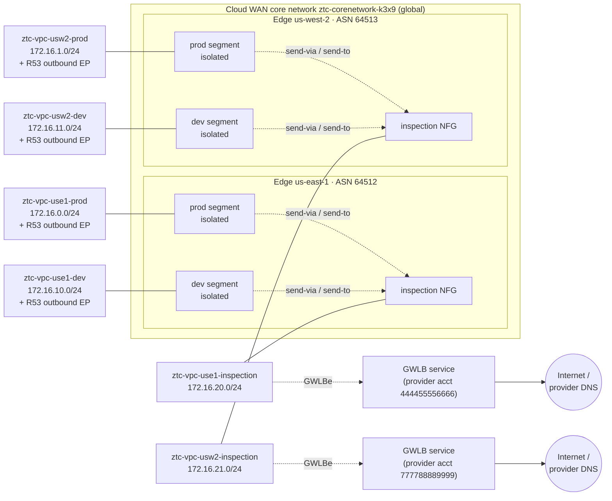
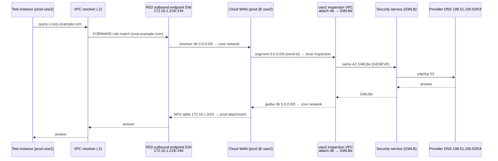
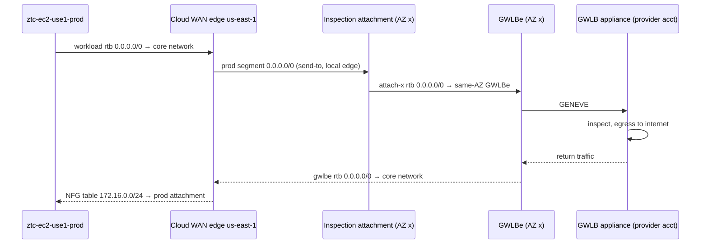

# Multi-Region AWS Cloud WAN with Regional GWLB Inspection: Reference Architecture

This reference architecture describes an AWS Cloud WAN core network that spans two regions (**us-east-1** and **us-west-2** in the examples) and carries two workload segments, `prod` and `dev`.

Both segments are isolated, so **every** flow between VPCs is steered through a regional `inspection` Network Function Group (NFG). That includes inter-segment flows and intra-segment flows. Internet-bound traffic and conditionally forwarded DNS go the same way. Each region's NFG member is an inspection VPC with Gateway Load Balancer (GWLB) endpoints. The endpoints point to a third-party security service, such as a cloud-delivered secure web gateway or firewall offered as a GWLB endpoint service.

The whole design is deployed with Terraform (≥ 1.9, AWS provider `~> 6.0`) from a small set of inputs.

> **About the values in this document**
>
> - All account IDs, resource IDs, service names, public IP addresses and domain names are **illustrative placeholders**:
>   - AWS documentation account IDs such as `111122223333`
>   - IDs containing `example`
>   - the RFC 5737 documentation ranges `198.51.100.0/24` and `203.0.113.0/24`
>   - the domain `corp.example.com`
> - Private `172.16.0.0/16` addresses show a sample address plan. Substitute your own values.
> - Resource names follow the convention in §3, with the sample suffix `k3x9`.

## 1. Overview



The routing view below shows the same design in terms of segments, the NFG and attachments. For a rule-by-rule analysis of the core network policy and the routes it installs, see [`CLOUDWAN_POLICY_ANALYSIS.md`](CLOUDWAN_POLICY_ANALYSIS.md).



| Component | Value |
|---|---|
| Global network | `ztc-globalnetwork-k3x9` · `global-network-0example000000001` |
| Core network | `ztc-corenetwork-k3x9` · `core-network-0example000000001` |
| Core network ASN range | `64512-64555` |
| Edge locations | `us-east-1` (ASN 64512), `us-west-2` (ASN 64513) |
| Segments | `prod` and `dev`, both with `isolate-attachments = true` |
| Network Function Group | `inspection`: one inspection VPC per region, each with two GWLB endpoints (one per AZ) |
| Address space | `172.16.0.0/16`, with one `/24` per VPC |
| VPC-to-VPC traffic | Always through exactly one GWLB appliance (single-hop `send-via`). For each cross-region pair Cloud WAN selects one region; in the reference deployment that was **us-east-1** (§5.4). |
| Internet access | Only through the **source region's** GWLB appliance. No VPC has an IGW, NAT gateway or public IP. |
| DNS | AmazonProvidedDNS (`VPC+2`) by default. `corp.example.com` is forwarded by a Route 53 Resolver outbound endpoint in each segment VPC to the security provider's DNS servers, through the local inspection VPC. |
| Test hosts | One Amazon Linux 2023 instance per segment VPC, optionally running a security agent installed by user data. Instances are reached through EC2 Instance Connect Endpoints. |

### 1.1 Design principles

1. **Everything is inspected.**
   - Attachments learn no routes from each other.
   - Every route in a segment points at an inspection attachment, apart from each VPC's own `local` route.
   - So a flow either crosses an appliance or is dropped. There is no bypass.
2. **Inspection is regional.**
   - Each region egresses through its own appliance, so internet traffic never crosses regions.
   - East-west traffic is inspected once (single-hop), never twice.
3. **One source of truth.**
   - Segments, edge locations, CIDRs and attachment tags are all derived from three inputs: `regions`, `segments` and `inspection_nfg_name`.
   - The policy document and the attachment tags are generated from the same names, so the two can't drift apart.
4. **No internet edge in AWS.** The GWLB appliance owns internet egress, so no VPC has an internet gateway or NAT.
5. **Consistent naming.** Every nameable resource follows `<prefix>-<type>-<context>[-<qualifier>]-<suffix>` (§3).

## 2. Design evolution

The design was reached in stages. Each stage is a separate core network policy version, so each step can be rolled back.

| Stage | Change | Before | After |
|---|---|---|---|
| 1 | Inter-segment inspection | Segments can't reach each other | Dual-hop `send-via` prod ↔ dev through the inspection NFG |
| 2 | Central egress | No internet access | Single-hop `send-via` plus `send-to`, with edge overrides forcing all egress through one region |
| 3 | Regional egress | Every region egresses through one region, and east-west traffic hairpins there | `egress_inspection = true` with **no edge overrides**, so each region uses its own inspection VPC |
| 4 | Intra-segment inspection | `isolate-attachments = false`, so prod ↔ prod and dev ↔ dev bypass inspection | Segments isolated, plus same-segment `send-via` (`dev → [dev, prod]`, `prod → [prod]`) |
| 5 | Naming standard | Ad-hoc names | `<name_prefix>-<type>-<context>[-<qualifier>]-<suffix>` on every nameable resource |
| 6 | Zone pinning | Subnets use each account's first AZ names | Attachment subnets are pinned by **zone ID** to the zones the GWLB service is offered in |
| 7 | Endpoint agent (optional) | Bare test instances | Test instances install a security agent through user data, from a sensitive provisioning key |
| 8 | Terraform hardening | Hard validation on the egress prerequisites; default attachment timeouts | The GWLB prerequisite becomes a `check` warning; attachments get 45-minute timeouts; `create_before_destroy` is removed where it would block in-place AZ changes |
| 9 | DNS conditional forwarding | VPC resolver only | A Route 53 Resolver outbound endpoint in each segment VPC forwards selected domains to the provider's DNS servers (§8.2) |

## 3. Naming

Every nameable resource is named `<name_prefix>-<type>-<context>[-<qualifier>]-<suffix>`.

| Part | Source | Example |
|---|---|---|
| `name_prefix` | variable, default `ztc` (lowercase, 1–16 characters) | `ztc` |
| `type` | resource type | `vpc`, `subnet`, `rtb`, `vpce`, `attachment`, `sg`, `sgr`, `eice`, `ec2`, `r53ep`, `r53rule`, `r53assoc`, `globalnetwork`, `corenetwork` |
| `context` | region code + VPC name, built in `locals.tf` (`us-east-1` → `use1`, `us-west-2` → `usw2`) | `use1-prod`, `usw2-inspection` |
| `qualifier` | a role, an AZ letter, or both | `attach-a`, `gwlbe-b`, `workload`, `resolver-b`, `instance`, `eice`, `r53ep`, `corp` |
| `suffix` | `random_string.suffix`, length `name_suffix_length` (default 4, range 3–8) | `k3x9` |

Examples: `ztc-vpc-use1-prod-k3x9`, `ztc-subnet-usw2-inspection-gwlbe-a-k3x9`, `ztc-r53rule-use1-dev-corp-k3x9`.

Notes:
- **Stability.** The suffix stays fixed once it's in state. It's there so that several deployments can coexist in one account.
- **AZ letters.** The AZ letter in a name is the account-specific AZ **name** (e.g. `us-east-1b`). Pinning uses zone **IDs** (e.g. `use1-az1`), because the mapping from AZ names to physical zones differs between accounts.
- **Renames.** Changing `name_prefix` or `name_suffix_length` renames everything:
  - Security groups are replaced with create-before-destroy.
  - EICEs must be deleted first, because only one EICE is allowed per subnet. Delete them with `aws ec2 delete-instance-connect-endpoint` and `terraform state rm` them before the apply.
  - Resolver endpoints and rules are renamed in place. Their subnets are renamed but not replaced.
- **Unnamed resources.** Routes, route-table associations and the policy attachment can't be named.

## 4. Code structure

| Path | Purpose |
|---|---|
| `variables.tf` | Inputs: `name_prefix`, `name_suffix_length`, `regions`, `segments`, `inspection_nfg_name`, `egress_inspection`, `dns_forwarding`, `deploy_test_instances`, `test_instance_type`, `test_instance_eice_regions`, and an optional sensitive agent provisioning key. `regions` also takes `gwlb_endpoint_service_name`, `az_ids`, `inspection_az_ids` and `workload_az_id`. Cross-variable validation needs Terraform ≥ 1.9. |
| `locals.tf` | Flattens `regions × (segments + NFG)` into `local.vpcs`, keyed `"<region>/<name>"`, with attachment tags, name context, AZ pins and the GWLB service. Derives `test_vpcs`, `gwlb_vpcs` and `dns_vpcs` from it. |
| `main.tf` | Random suffix, global network, core network (`create_base_policy = false`), the generated policy document, the policy attachment, the module instances, and the `egress_inspection_gwlb` check |
| `modules/vpc` | One VPC (DNS support and hostnames on), attachment subnets (zones optionally pinned by zone ID), the Cloud WAN VPC attachment (appliance mode for inspection VPCs, 45-minute timeouts), and an optional workload subnet, route table and route |
| `modules/gwlb_inspection` | Per-AZ GWLB endpoints, the endpoint subnets, per-AZ attachment route tables (`0/0 → same-AZ GWLBe`), and the GWLBe route table (`0/0 → core network`) |
| `modules/dns_forwarding` | Per segment VPC: two resolver /27 subnets and their route table, a Route 53 Resolver outbound endpoint and its security group, FORWARD and SYSTEM rules, and the rules' VPC associations |
| `modules/test_instance` | An Amazon Linux 2023 test instance (optional agent user data), its security groups, and an optional EC2 Instance Connect Endpoint |
| `version.tf` | Terraform `>= 1.9`; providers `aws ~> 6.0` and `random ~> 3.6`; a single AWS provider |

**One provider, regional resources.** The configuration has a single AWS provider with no aliases. Every regional resource sets the AWS provider v6 `region` argument itself, which is what allows each module to use `for_each` across regions. Network Manager resources are global and take no `region`.

**Dependency wiring.** `module.vpc` receives `core_network_id` from the **policy attachment**, not from the core network. As a result, VPC attachments are created only after the policy has created the edge locations. Don't replace this with a module-level `depends_on`. That would defer the AZ data source to apply time, and every policy edit would then force subnet replacement.

## 5. Core network policy

The policy document is generated in `main.tf` (`data.aws_networkmanager_core_network_policy_document.core_policy`) entirely from inputs. It is applied with `aws_networkmanager_core_network_policy_attachment`. Render the JSON with `terraform plan`, or download the live version with `aws networkmanager get-core-network-policy`, and review it before applying.

### 5.1 Core network configuration

| Setting | Value | Notes |
|---|---|---|
| `asn-ranges` | `64512-64555` | Each region's ASN must fall in this range (validated) |
| `vpn-ecmp-support` | `false` | There are no VPN attachments |
| `dns-support` | `true` (default) | Enables private DNS resolution across attachments |
| `security-group-referencing-support` | `false` (default) | Security groups can't reference groups in other VPCs, so cross-VPC rules use CIDRs |

### 5.2 Segments

| Segment | Description | `isolate-attachments` | `require-attachment-acceptance` |
|---|---|---|---|
| `dev` | Development Workload Segment | `true` | `false` |
| `prod` | Production Workload Segment | `true` | `false` |

- **Isolation.** Attachments in a segment learn no routes from each other. Any reachability comes from the segment actions instead. So the only path between two VPCs, in the same segment or not, is through the inspection NFG.
- **No acceptance step.** An attachment that carries a matching tag joins the segment at once.

### 5.3 Attachment policies (tag-driven membership)

| Rule | Condition | Action |
|---|---|---|
| 100 | tag `Segment = dev` | associate with segment `dev` |
| 200 | tag `Segment = prod` | associate with segment `prod` |
| 1000 | tag `NetworkFunctionGroup = inspection` | add to NFG `inspection` |

- **Rule order.** Rules are evaluated lowest number first, and the first match wins. Segment rules are numbered `100 × position` in the sorted segment keys. Adding a segment that sorts earlier renumbers the existing rules. That is harmless, but it's still a policy change.
- **Tags come from the code.** `locals.tf` generates the attachment tags from the same names the policy matches on, so tags and policy can't drift apart.
- **No match, no routes.** An attachment that matches no rule isn't associated with anything and gets no routes.
- **Risk.** With acceptance off, anyone who can create an attachment to this core network and tag it `NetworkFunctionGroup=inspection` would join the NFG. See §11.

### 5.4 Segment actions (service insertion)

| Action | Segment | Target | Mode | Effect |
|---|---|---|---|---|
| `send-via` | `dev` → `[dev, prod]` | NFG `inspection` | `single-hop` | `dev` ↔ `dev` and `dev` ↔ `prod` cross one inspection attachment |
| `send-via` | `prod` → `[prod]` | NFG `inspection` | `single-hop` | `prod` ↔ `prod` crosses one inspection attachment |
| `send-to` | `dev` | NFG `inspection` | — | Installs `0.0.0.0/0` and `::/0` in `dev`, pointing at the **local** inspection attachment |
| `send-to` | `prod` | NFG `inspection` | — | Installs `0.0.0.0/0` and `::/0` in `prod`, pointing at the **local** inspection attachment |

- **One action per unordered pair.**
  - `send-via` is bidirectional: it installs routes in both segments of a pair.
  - Terraform emits, for each segment, the segment itself plus every segment after it in sorted order. That gives one action per unordered pair, same-segment pairs included, without duplicates.
  - Adding a segment `qa` would give `dev → [dev, prod, qa]`, `prod → [prod, qa]` and `qa → [qa]`.
- **No edge overrides.** Each edge sends egress to its local inspection attachment.
- **Single-hop is required.**
  - Cloud WAN rejects an NFG that is used by both a dual-hop `send-via` and a `send-to` (`NETWORK_FUNCTION_GROUP_EXCLUSIVITY_VIOLATION`).
  - Single-hop means each east-west flow crosses exactly **one** inspection attachment.
- **Which region inspects:**
  - Traffic within a region is inspected in that region.
  - For a cross-region pair, Cloud WAN picks one region's inspection attachment, since no override is set. In the reference deployment, the route tables showed it chose **us-east-1** for the use1 ↔ usw2 pair, in both directions and for both segments.
  - The us-west-2 appliance therefore sees only traffic between us-west-2 VPCs, plus us-west-2 egress and DNS.
- **IPv6.** `send-to` also installs `::/0`. The VPCs have no IPv6, so this route does nothing today.
- **With `egress_inspection = false`:**
  - The `send-to` actions are removed.
  - `send-via` reverts to `dual-hop`, inspected at both edges.
  - Workload routes cover only `172.16.0.0/16`.
  - `dns_forwarding` is rejected by validation.

### 5.5 Effective routes

**Segment route tables.** These are identical for `prod` and `dev`. All routes are active.

| Destination | at us-east-1 edge | at us-west-2 edge | Source |
|---|---|---|---|
| `0.0.0.0/0`, `::/0` | use1 inspection `attachment-0example000000001` | usw2 inspection `attachment-0example000000002` | `send-to` (static) |
| 172.16.0.0/24, 172.16.10.0/24 (use1 VPCs) | use1 inspection | **use1 inspection** | `send-via` |
| 172.16.1.0/24, 172.16.11.0/24 (usw2 VPCs) | **use1 inspection** | usw2 inspection | `send-via` |

**NFG `inspection` route tables.** These decide where traffic goes after inspection.

| Destination | inspection at us-east-1 | inspection at us-west-2 |
|---|---|---|
| 172.16.0.0/24 (use1 prod) | `attachment-0example000000003` | NFG at us-east-1 |
| 172.16.10.0/24 (use1 dev) | `attachment-0example000000004` | NFG at us-east-1 |
| 172.16.1.0/24 (usw2 prod) | NFG at us-west-2 | `attachment-0example000000005` |
| 172.16.11.0/24 (usw2 dev) | NFG at us-west-2 | `attachment-0example000000006` |

What the route tables show:
- **No direct workload routes.** No segment route points straight at a workload attachment. That is the combined effect of isolation and same-segment `send-via`.
- **No default route in the NFG tables.** Internet traffic never comes back into Cloud WAN, because the appliance carries it out itself.
- **Inspection VPCs are unreachable from workloads.** The inspection VPC CIDRs (`172.16.20.0/24` and `172.16.21.0/24`) appear in no segment table.

To refresh these tables:

```sh
aws networkmanager get-network-routes --global-network-id global-network-0example000000001 \
  --route-table-identifier 'CoreNetworkSegmentEdge={CoreNetworkId=core-network-0example000000001,SegmentName=prod,EdgeLocation=us-west-2}'
```

## 6. VPC design

Every region has one VPC per segment plus one inspection VPC. Each VPC `/24` is split into four `/26` blocks (`cidrsubnet(cidr, 2, i)`). In segment VPCs, the 4th block is split again into two `/27`s for DNS.

| Block | Segment VPC | Inspection VPC |
|---|---|---|
| `/26` #0 (`.0`) | Cloud WAN attachment subnet (AZ 1) | Cloud WAN attachment subnet (AZ 1) |
| `/26` #1 (`.64`) | Cloud WAN attachment subnet (AZ 2) | Cloud WAN attachment subnet (AZ 2) |
| `/26` #2 (`.128`) | Workload subnet (test instances, AZ 1 or `workload_az_id`) | GWLB endpoint subnet (AZ 1) |
| `/26` #3 (`.192`) | Two resolver `/27`s: `.192` (AZ 1) and `.224` (AZ 2), via `cidrsubnet(cidr, 3, 6..7)` | GWLB endpoint subnet (AZ 2) |

- **Segment VPCs are full.** Adding another subnet tier needs a larger VPC CIDR.
- **Attachment subnets hold only the attachment ENIs.** They use each VPC's main route table, with `local` only. Traffic arriving from Cloud WAN is for a destination inside the VPC, so it needs nothing more.

### 6.1 VPCs and attachments

| VPC | VPC ID | Attachment | Attachment ID | Membership | Appliance mode |
|---|---|---|---|---|---|
| `ztc-vpc-use1-prod-k3x9` | `vpc-0example000000001` | `ztc-attachment-use1-prod-k3x9` | `attachment-0example000000003` | segment `prod` | off |
| `ztc-vpc-use1-dev-k3x9` | `vpc-0example000000002` | `ztc-attachment-use1-dev-k3x9` | `attachment-0example000000004` | segment `dev` | off |
| `ztc-vpc-use1-inspection-k3x9` | `vpc-0example000000003` | `ztc-attachment-use1-inspection-k3x9` | `attachment-0example000000001` | NFG `inspection` | **on** |
| `ztc-vpc-usw2-prod-k3x9` | `vpc-0example000000004` | `ztc-attachment-usw2-prod-k3x9` | `attachment-0example000000005` | segment `prod` | off |
| `ztc-vpc-usw2-dev-k3x9` | `vpc-0example000000005` | `ztc-attachment-usw2-dev-k3x9` | `attachment-0example000000006` | segment `dev` | off |
| `ztc-vpc-usw2-inspection-k3x9` | `vpc-0example000000006` | `ztc-attachment-usw2-inspection-k3x9` | `attachment-0example000000002` | NFG `inspection` | **on** |

- **State.** All attachments are `AVAILABLE`. Creating or deleting one takes 10–15 minutes, so the Terraform timeouts are 45 minutes.
- **Appliance mode** pins both directions of a flow to the same AZ inside the inspection VPC. GWLB needs that symmetry, because each AZ's appliance only knows its own flows.
- **DNS.** All VPCs have `enable_dns_support` and `enable_dns_hostnames` turned on.

### 6.2 Subnets

| Subnet | CIDR | AZ · zone ID | Subnet ID |
|---|---|---|---|
| `ztc-subnet-use1-prod-attach-b-k3x9` | `172.16.0.0/26` | us-east-1b · use1-az1 | `subnet-0example000000001` |
| `ztc-subnet-use1-prod-attach-c-k3x9` | `172.16.0.64/26` | us-east-1c · use1-az2 | `subnet-0example000000002` |
| `ztc-subnet-use1-prod-workload-k3x9` | `172.16.0.128/26` | us-east-1b · use1-az1 | `subnet-0example000000003` |
| `ztc-subnet-use1-prod-resolver-b-k3x9` | `172.16.0.192/27` | us-east-1b · use1-az1 | `subnet-0example000000004` |
| `ztc-subnet-use1-prod-resolver-c-k3x9` | `172.16.0.224/27` | us-east-1c · use1-az2 | `subnet-0example000000005` |
| `ztc-subnet-use1-dev-attach-b-k3x9` | `172.16.10.0/26` | us-east-1b · use1-az1 | `subnet-0example000000006` |
| `ztc-subnet-use1-dev-attach-c-k3x9` | `172.16.10.64/26` | us-east-1c · use1-az2 | `subnet-0example000000007` |
| `ztc-subnet-use1-dev-workload-k3x9` | `172.16.10.128/26` | us-east-1b · use1-az1 | `subnet-0example000000008` |
| `ztc-subnet-use1-dev-resolver-b-k3x9` | `172.16.10.192/27` | us-east-1b · use1-az1 | `subnet-0example000000009` |
| `ztc-subnet-use1-dev-resolver-c-k3x9` | `172.16.10.224/27` | us-east-1c · use1-az2 | `subnet-0example000000010` |
| `ztc-subnet-use1-inspection-attach-b-k3x9` | `172.16.20.0/26` | us-east-1b · use1-az1 | `subnet-0example000000011` |
| `ztc-subnet-use1-inspection-attach-c-k3x9` | `172.16.20.64/26` | us-east-1c · use1-az2 | `subnet-0example000000012` |
| `ztc-subnet-use1-inspection-gwlbe-b-k3x9` | `172.16.20.128/26` | us-east-1b · use1-az1 | `subnet-0example000000013` |
| `ztc-subnet-use1-inspection-gwlbe-c-k3x9` | `172.16.20.192/26` | us-east-1c · use1-az2 | `subnet-0example000000014` |
| `ztc-subnet-usw2-prod-attach-a-k3x9` | `172.16.1.0/26` | us-west-2a · usw2-az2 | `subnet-0example000000015` |
| `ztc-subnet-usw2-prod-attach-b-k3x9` | `172.16.1.64/26` | us-west-2b · usw2-az1 | `subnet-0example000000016` |
| `ztc-subnet-usw2-prod-workload-k3x9` | `172.16.1.128/26` | us-west-2a · usw2-az2 | `subnet-0example000000017` |
| `ztc-subnet-usw2-prod-resolver-a-k3x9` | `172.16.1.192/27` | us-west-2a · usw2-az2 | `subnet-0example000000018` |
| `ztc-subnet-usw2-prod-resolver-b-k3x9` | `172.16.1.224/27` | us-west-2b · usw2-az1 | `subnet-0example000000019` |
| `ztc-subnet-usw2-dev-attach-a-k3x9` | `172.16.11.0/26` | us-west-2a · usw2-az2 | `subnet-0example000000020` |
| `ztc-subnet-usw2-dev-attach-b-k3x9` | `172.16.11.64/26` | us-west-2b · usw2-az1 | `subnet-0example000000021` |
| `ztc-subnet-usw2-dev-workload-k3x9` | `172.16.11.128/26` | us-west-2a · usw2-az2 | `subnet-0example000000022` |
| `ztc-subnet-usw2-dev-resolver-a-k3x9` | `172.16.11.192/27` | us-west-2a · usw2-az2 | `subnet-0example000000023` |
| `ztc-subnet-usw2-dev-resolver-b-k3x9` | `172.16.11.224/27` | us-west-2b · usw2-az1 | `subnet-0example000000024` |
| `ztc-subnet-usw2-inspection-attach-a-k3x9` | `172.16.21.0/26` | us-west-2a · usw2-az2 | `subnet-0example000000025` |
| `ztc-subnet-usw2-inspection-attach-b-k3x9` | `172.16.21.64/26` | us-west-2b · usw2-az1 | `subnet-0example000000026` |
| `ztc-subnet-usw2-inspection-gwlbe-a-k3x9` | `172.16.21.128/26` | us-west-2a · usw2-az2 | `subnet-0example000000027` |
| `ztc-subnet-usw2-inspection-gwlbe-b-k3x9` | `172.16.21.192/26` | us-west-2b · usw2-az1 | `subnet-0example000000028` |

### 6.3 Availability-zone pinning

| Setting | Scope | Value | Why |
|---|---|---|---|
| `regions["us-east-1"].az_ids` | attachment subnets of every us-east-1 VPC (resolver subnets follow them) | `["use1-az1", "use1-az2"]` | The us-east-1 GWLB service is offered only in these zones. The default AZ names (1a/1b) would have included use1-az6. |
| `regions[<r>].inspection_az_ids` | inspection VPC only (overrides `az_ids`) | unset | Use it if the GWLB service's zones differ from the region's other VPCs |
| `regions["us-east-1"].workload_az_id` | the test-instance subnet in us-east-1 segment VPCs | `use1-az1` | Puts the instance in the same zone as an attachment subnet and a GWLB endpoint |
| (us-west-2) | all | first two AZ names: `usw2-az2` and `usw2-az1` | Matches the us-west-2 service's zones |

- **Why zone IDs.** Pinning uses zone **IDs**. Each account maps AZ names to physical zones differently, while a GWLB service is offered in fixed physical zones.
- **Changing the zones of an existing VPC replaces its attachment.**
  - The replacement subnets reuse the old CIDRs, so the old attachment and subnets must be destroyed **before** the new ones are created. The plan must show `-/+`, not `+/-`.
  - Expect about 30 minutes and an inspection outage in that region.
  - Turn off DNS forwarding first, because resolver subnets follow the same AZs.

## 7. Inspection (GWLB)

| Region | Endpoint service | Provider account | Offered zones | Endpoints |
|---|---|---|---|---|
| us-east-1 | `com.amazonaws.vpce.us-east-1.vpce-svc-0example000000002` | `444455556666` | use1-az1, use1-az2 | `ztc-vpce-use1-inspection-b-k3x9` (`vpce-0example000000001`), `ztc-vpce-use1-inspection-c-k3x9` (`vpce-0example000000002`) |
| us-west-2 | `com.amazonaws.vpce.us-west-2.vpce-svc-0example000000003` | `777788889999` | usw2-az2, usw2-az1 | `ztc-vpce-usw2-inspection-a-k3x9` (`vpce-0example000000003`), `ztc-vpce-usw2-inspection-b-k3x9` (`vpce-0example000000004`) |

- **Status.** All endpoints are `available`, and both services accept connections automatically.
- **Outside this configuration.** The security appliances, their policy, their logging and their internet egress all run in the provider's accounts.
- **Zone check.** Terraform can't check that a service is offered in the inspection subnets' zones, because `aws_vpc_endpoint_service` isn't region-scoped in provider v6. Check it by hand before changing `gwlb_endpoint_service_name` (§12).

### 7.1 Inspection VPC routing

| Route table | ID | Associated subnets | Routes |
|---|---|---|---|
| `ztc-rtb-use1-inspection-attach-b-k3x9` | `rtb-0example000000001` | attach-b | `local`; `0.0.0.0/0 → ztc-vpce-use1-inspection-b` |
| `ztc-rtb-use1-inspection-attach-c-k3x9` | `rtb-0example000000002` | attach-c | `local`; `0.0.0.0/0 → ztc-vpce-use1-inspection-c` |
| `ztc-rtb-use1-inspection-gwlbe-k3x9` | `rtb-0example000000003` | gwlbe-b, gwlbe-c | `local`; `0.0.0.0/0 → core network` |
| `ztc-rtb-usw2-inspection-attach-a-k3x9` | `rtb-0example000000004` | attach-a | `local`; `0.0.0.0/0 → ztc-vpce-usw2-inspection-a` |
| `ztc-rtb-usw2-inspection-attach-b-k3x9` | `rtb-0example000000005` | attach-b | `local`; `0.0.0.0/0 → ztc-vpce-usw2-inspection-b` |
| `ztc-rtb-usw2-inspection-gwlbe-k3x9` | `rtb-0example000000006` | gwlbe-a, gwlbe-b | `local`; `0.0.0.0/0 → core network` |

Path through an inspection VPC:

```
Cloud WAN → attachment ENI (AZ x) → [attach-x rtb] → GWLBe (AZ x) → GENEVE → appliance
          ← core network ← [gwlbe rtb] ← GWLBe (AZ x) ← GENEVE ← appliance (east-west return)
                                                       appliance → internet (egress, DNS)
```

- **East-west traffic** comes back out of the GWLBe and returns to Cloud WAN through the GWLBe route table. Cloud WAN then delivers it using the NFG route table (§5.5).
- **Internet and DNS traffic** leaves from the appliance in the provider account. Replies come back the same way, then go GWLBe → core network → NFG table → source VPC.
- **Per-AZ attachment route tables** keep a flow in its arrival AZ. Each table points only at its own AZ's endpoint. A shared table would send cross-AZ traffic to one endpoint and break symmetry.

## 8. Workload VPC routing, test instances and DNS

### 8.1 Workload routing and test instances

Test instances are enabled (`deploy_test_instances = true`) in every segment VPC.

| Route table | ID | Associated subnets | Routes |
|---|---|---|---|
| `ztc-rtb-use1-prod-workload-k3x9` | `rtb-0example000000007` | workload | `local`; `0.0.0.0/0 → core network` |
| `ztc-rtb-use1-dev-workload-k3x9` | `rtb-0example000000008` | workload | `local`; `0.0.0.0/0 → core network` |
| `ztc-rtb-usw2-prod-workload-k3x9` | `rtb-0example000000009` | workload | `local`; `0.0.0.0/0 → core network` |
| `ztc-rtb-usw2-dev-workload-k3x9` | `rtb-0example000000010` | workload | `local`; `0.0.0.0/0 → core network` |
| Main route table (each VPC) | — | attachment subnets | `local` only |

- **Route destination.** With `egress_inspection = false`, the workload route is `172.16.0.0/16 → core network` instead (`cloudwan_destination_cidr`).
- **Route ordering.** The route `depends_on` the VPC attachment, because Cloud WAN accepts routes only from VPCs whose attachment is available.
- **No create-before-destroy.** The route deliberately has no `create_before_destroy`. It would spread to the attachment and its subnets, and an AZ change would then try to create the replacement subnet (same CIDR) before deleting the old one.

| Instance | ID | Private IP | AZ · zone | Security group | Access |
|---|---|---|---|---|---|
| `ztc-ec2-use1-prod-k3x9` | `i-0example000000001` | `172.16.0.186` | us-east-1b · use1-az1 | `ztc-sg-use1-prod-instance-k3x9` (`sg-0example000000001`) | jump through a us-west-2 instance |
| `ztc-ec2-use1-dev-k3x9` | `i-0example000000002` | `172.16.10.133` | us-east-1b · use1-az1 | `ztc-sg-use1-dev-instance-k3x9` (`sg-0example000000002`) | jump through a us-west-2 instance |
| `ztc-ec2-usw2-prod-k3x9` | `i-0example000000003` | `172.16.1.143` | us-west-2a · usw2-az2 | `ztc-sg-usw2-prod-instance-k3x9` (`sg-0example000000003`) | EICE `ztc-eice-usw2-prod-k3x9` (`eice-0example000000001`) |
| `ztc-ec2-usw2-dev-k3x9` | `i-0example000000004` | `172.16.11.182` | us-west-2a · usw2-az2 | `ztc-sg-usw2-dev-instance-k3x9` (`sg-0example000000004`) | EICE `ztc-eice-usw2-dev-k3x9` (`eice-0example000000002`) |

**Instance build:**
- `t3.micro` running Amazon Linux 2023. The AMI comes from the SSM public parameter, and later AMI changes are ignored.
- IMDSv2 is required, and the root volume is gp3 and encrypted.

**Endpoint agent (optional):**
- When a provisioning key is supplied, a user-data template installs the security provider's endpoint agent and writes the key to the instance. It logs to a file under `/var/log`.
- `user_data_replace_on_change = true`, so changing the key or the template **replaces** the instances, which get new IDs and IPs.

**EICE placement:**
- EC2 Instance Connect Endpoints are limited to 5 per account per region.
- `test_instance_eice_regions` limits them to selected regions, `["us-west-2"]` in the examples. Instances in other regions are reached by jumping through an instance that has one.
- In regions without an EICE, the `ztc-sg-<ctx>-eice` groups exist but are unused.

### 8.2 DNS conditional forwarding (`dns_forwarding`)

This is off by default (`null`). When set, `modules/dns_forwarding` gives every segment VPC a Route 53 Resolver outbound endpoint. One endpoint per VPC was chosen over one shared endpoint per region, for two reasons:
- Each VPC's queries leave from its own segment, so the security service sees the right source segment.
- No segment depends on another segment's VPC.

**Example configuration:**

```hcl
dns_forwarding = {
  target_ips   = ["198.51.100.53", "198.51.100.54"]   # provider DNS servers
  domain_names = { corp = "corp.example.com" }            # FORWARD rules
  # system_domains = { ... }                           # SYSTEM rules (none)
}
```

| VPC | Endpoint | Endpoint IPs | Resolver route table | Endpoint SG | FORWARD rule | Association |
|---|---|---|---|---|---|---|
| use1 prod | `ztc-r53ep-use1-prod-k3x9` (`rslvr-out-0example000000001`) | 172.16.0.200, 172.16.0.244 | `rtb-0example000000011` | `sg-0example000000005` | `rslvr-rr-0example000000001` | `rslvr-rrassoc-0example000000001` |
| use1 dev | `ztc-r53ep-use1-dev-k3x9` (`rslvr-out-0example000000002`) | 172.16.10.207, 172.16.10.233 | `rtb-0example000000012` | `sg-0example000000006` | `rslvr-rr-0example000000002` | `rslvr-rrassoc-0example000000002` |
| usw2 prod | `ztc-r53ep-usw2-prod-k3x9` (`rslvr-out-0example000000003`) | 172.16.1.219, 172.16.1.244 | `rtb-0example000000013` | `sg-0example000000007` | `rslvr-rr-0example000000003` | `rslvr-rrassoc-0example000000003` |
| usw2 dev | `ztc-r53ep-usw2-dev-k3x9` (`rslvr-out-0example000000004`) | 172.16.11.207, 172.16.11.239 | `rtb-0example000000014` | `sg-0example000000008` | `rslvr-rr-0example000000004` | `rslvr-rrassoc-0example000000004` |

**Components in each VPC:**

| Component | Detail |
|---|---|
| Resolver subnets | `ztc-subnet-<ctx>-resolver-<az>-k3x9`: `.192/27` and `.224/27`, in the two attachment-subnet AZs |
| Route table | `ztc-rtb-<ctx>-resolver-k3x9`: `local`; `0.0.0.0/0 → core network`. The route waits for the VPC attachment. |
| Endpoint | `ztc-r53ep-<ctx>-k3x9`: OUTBOUND, protocol Do53, one IP per resolver subnet (2 AZs) |
| Security group | `ztc-sg-<ctx>-r53ep-k3x9`: egress udp/53 and tcp/53 to each target `/32` only. No ingress, since an outbound endpoint receives nothing. |
| Rules | FORWARD `ztc-r53rule-<ctx>-<key>-k3x9` sends `domain_names` → `target_ips:53`. SYSTEM `ztc-r53rule-<ctx>-sys-<key>-k3x9` makes AWS resolve `system_domains` itself. Each rule is associated with its own VPC (`ztc-r53assoc-…`). |

**Query path:**



**Design notes:**
- **Rule precedence.**
  - Route 53 Resolver uses the **most specific** matching rule.
  - A SYSTEM rule for a subdomain therefore overrides a broader FORWARD rule. For example, forwarding `.` while keeping the provider's own service domains on AWS.
  - With only `corp.example.com` forwarded, every other name already resolves through AWS, so no SYSTEM rules are needed.
- **Requires `egress_inspection`.**
  - The endpoint subnets reach the targets only through the segment's `0.0.0.0/0` `send-to` route.
  - `dns_forwarding` therefore requires `egress_inspection = true`, enforced by variable validation.
  - No Cloud WAN policy change is needed.
- **No create-before-destroy on the endpoint.** It would spread to the resolver subnets, whose replacements reuse the same CIDRs. The security group does have create-before-destroy, so it can be renamed while still attached.
- **Inputs are validated:**
  - 1–6 IPv4 targets (the per-rule limit is 6).
  - Domain keys match `[a-z0-9-]{1,20}`, because they appear in names.
  - `attachment_subnets` must have exactly 2 entries.
- **Quota.**
  - The limit is 4 resolver endpoints per account per region (`L-4A669CC0`, adjustable).
  - One endpoint per segment VPC needs 2 per region in this design. In shared accounts, check current usage and request an increase before applying.
- **Cost.** 8 endpoint ENIs at about $0.125 per hour comes to about $730 a month, plus per-query charges.

**Verification:**
- **Targets reachable.** From each test instance, the target IPs answer on udp and tcp 53 (`dig @198.51.100.53 example.com`).
- **Only through the gateway.** If the targets accept queries only through the security service, they time out from outside hosts. That confirms the path goes through inspection.
- **Forwarded domain.** `dig corp.example.com` through the VPC resolver returns the provider's answer. The domain must be configured on the provider side, or the answer is `NXDOMAIN`.
- **Other names.** Other names, such as `example.com`, still resolve through AWS.

## 9. Traffic flows

| # | Flow | Path | Inspected | Validated |
|---|---|---|---|---|
| 1 | prod use1 ↔ prod usw2 (intra-segment, cross-region) | VPC → `prod` → **use1** inspection → NFG → `prod` → VPC | Yes, once (us-east-1) | ✅ ICMP and SSH, both directions |
| 2 | dev use1 ↔ dev usw2 (intra-segment, cross-region) | As #1, in `dev` | Yes, once (us-east-1) | ✅ |
| 3 | prod ↔ dev, same region | VPC → segment → local inspection → NFG → other segment's VPC | Yes, once, locally | ✅ in both regions |
| 4 | prod ↔ dev, cross-region | VPC → segment → **use1** inspection → NFG → other region's VPC | Yes, once (us-east-1) | ✅ both pairs, both directions |
| 5 | Two VPCs in the same segment and region | VPC → segment → local inspection → NFG → VPC | Yes, once, locally | Not testable: there's one VPC per segment per region |
| 6 | Within one VPC | VPC `local` route; never reaches Cloud WAN | **No** | n/a |
| 7 | Any workload → internet | VPC `0/0` → segment `send-to` → **local** inspection → appliance → internet | Yes, in the source region | ✅ HTTP/HTTPS 200 and ICMP to 8.8.8.8 from all 4 instances |
| 8 | Conditional DNS (`corp.example.com`) | VPC resolver → R53 outbound endpoint → as #7 → provider DNS | Yes, in the source region | ✅ targets reachable (§8.2) |
| 9 | Internet → workload (unsolicited) | No inbound path: no IGW, public IP or load balancer | n/a | n/a |
| 10 | Workload → inspection VPC subnets | No route in any segment | n/a (blocked) | n/a |

**Egress path from a us-east-1 workload:**



**Cross-region east-west (usw2 prod → use1 prod):**
1. The usw2 prod VPC sends to the usw2 edge. Its `prod` table has `172.16.0.0/24 → use1 inspection attachment`, so the packet crosses the backbone.
2. use1 inspection hands it to the appliance, and the packet comes back through the GWLBe.
3. NFG at use1: `172.16.0.0/24 → use1 prod attachment`.
4. The reply follows the mirror path. The `prod` table at use1 has `172.16.1.0/24 → use1 inspection`. Then NFG at use1 sends it to NFG at usw2, and from there to the usw2 prod attachment.

Both directions cross the **same** appliance, in the same AZ.

**Egress IPs:**
- `curl https://checkip.amazonaws.com` from each region shows that region's provider egress addresses, e.g. `203.0.113.11` in us-west-2 and `203.0.113.21` in us-east-1.
- Different addresses per region confirm that each region egresses through its own appliance.

## 10. Security controls

### 10.1 Network segmentation and inspection

| Control | Implementation |
|---|---|
| Segment isolation | `prod` and `dev` are separate Cloud WAN segments with `isolate-attachments = true`. No two attachments share routes except through the inspection NFG. |
| Inter-segment inspection | All `prod` ↔ `dev` traffic is forced through a GWLB appliance (`send-via`, single-hop). |
| Intra-segment inspection | All `prod` ↔ `prod` and `dev` ↔ `dev` traffic between VPCs is forced through a GWLB appliance (same-segment `send-via`). |
| Regional egress inspection | All internet-bound traffic and forwarded DNS is forced through the **source region's** appliance (`send-to`, no edge overrides). There is no other egress path. |
| Tag-based membership | Segment and NFG membership comes from attachment tags generated in `locals.tf`. Nothing is hardcoded. |
| Flow symmetry | Appliance mode on inspection attachments, plus per-AZ attachment route tables that point at same-AZ endpoints |
| No internet edge | No VPC has an IGW, NAT gateway, Elastic IP or public subnet. Test instances set `associate_public_ip_address = false`. |
| Inspection subnets hidden | Inspection VPC CIDRs aren't propagated to any segment, so workloads can't reach the GWLBe or attachment subnets. |
| Fail closed | If inspection is unavailable, traffic is dropped; it never bypasses inspection. The `egress_inspection_gwlb` **check** warns at plan time when a region has no GWLB service. It's a warning rather than an error, so a region's endpoints can be removed while its service is swapped. |

### 10.2 Security groups

| Security group | Rule (Name tag) | Direction | Protocol / port | Peer |
|---|---|---|---|---|
| `ztc-sg-<ctx>-instance-k3x9` | `ztc-sgr-<ctx>-ssh-from-eice-k3x9` | Ingress | TCP 22 | EICE security group |
| | `ztc-sgr-<ctx>-from-cloudwan-k3x9` | Ingress | All | `172.16.0.0/16` (all Cloud WAN address space) |
| | `ztc-sgr-<ctx>-all-egress-k3x9` | Egress | All | `0.0.0.0/0` |
| `ztc-sg-<ctx>-eice-k3x9` | `ztc-sgr-<ctx>-ssh-to-instance-k3x9` | Egress | TCP 22 | Instance security group |
| `ztc-sg-<ctx>-r53ep-k3x9` | `ztc-sgr-<ctx>-dns-{udp,tcp}-<target>-k3x9` | Egress | UDP and TCP 53 | each `target_ip/32` |

- **Contexts.** `<ctx>` is `use1-prod`, `use1-dev`, `usw2-prod` or `usw2-dev`.
- **Rules as separate resources.** Rules are separate `aws_vpc_security_group_*_rule` resources. This avoids a reference cycle between the instance and EICE groups.
- **Create-before-destroy.** All groups use `create_before_destroy`, so they can be renamed while still attached.

### 10.3 Host and access controls

| Control | Implementation |
|---|---|
| Administrative access | EC2 Instance Connect Endpoint only. Access is authorised by IAM (`OpenTunnel`, `SendSSHPublicKey`) and logged in CloudTrail. There is no bastion, and no SSH keys are stored in Terraform. Pushed keys are valid for 60 seconds. |
| Instance metadata | IMDSv2 required (`http_tokens = "required"`) |
| Storage | Root EBS volumes are gp3 and encrypted |
| OS image | The latest Amazon Linux 2023 from the SSM public parameter, resolved at creation. Later AMI changes are ignored. |
| Endpoint agent | Optional security agent, installed by user data |

### 10.4 Network ACLs

All subnets use the VPC default NACL, which allows all traffic. Filtering relies on Cloud WAN segmentation, the GWLB appliances and security groups.

## 11. Known gaps and risks

| Area | Gap | Impact / suggestion |
|---|---|---|
| Inspection dependency | Segments are isolated, so every VPC-to-VPC flow depends on the GWLB appliances | An outage or a missing allow rule drops even same-segment traffic. Monitor appliance and GWLBe health in both regions. |
| Inspection-region concentration | Without edge overrides, Cloud WAN picks one region to inspect each cross-region pair. In the reference deployment, us-east-1 inspected **all** of them. | A us-east-1 appliance failure cuts all cross-region traffic as well as us-east-1 itself. Appliance policy in us-east-1 must allow us-west-2 sources. Consider pinning with `with-edge-overrides` so the choice is explicit and stable. |
| Attachment auto-acceptance | `require-attachment-acceptance = false` on the segments **and the NFG** | A wrongly or maliciously tagged attachment joins `prod`, or becomes an inspection target. Require acceptance at least on the NFG, and restrict attachment creation and tagging with IAM or SCPs. |
| Appliance ownership | Inspection rules, logging and egress run in third-party accounts | Security posture depends on those providers. Document their controls and SLAs separately. |
| Secrets | The agent provisioning key ends up in instance user data (readable with `ec2:DescribeInstanceAttribute`) and in Terraform state | Pass it in with `TF_VAR_…` or an untracked tfvars, use an encrypted remote backend, restrict `DescribeInstanceAttribute`, and rotate the key after testing. Alternatively, fetch it at boot from Secrets Manager. |
| Terraform state | State holds resource IDs and sensitive inputs | Use a remote backend (e.g. S3 with locking and encryption) for anything beyond a lab |
| Test instance SG | Allows all protocols from `172.16.0.0/16` | Fine for connectivity tests. Don't reuse it for real workloads. |
| Visibility | No VPC Flow Logs, Resolver query logs or Cloud WAN event monitoring | Add flow logs (at least on inspection VPCs), Route 53 Resolver query logging, and Network Manager events to CloudWatch. |
| IPv6 | `send-to` installs `::/0` | Harmless now. Confirm the appliance supports IPv6 before enabling it in any VPC. |
| Default resources | Default security groups and NACLs are left unmanaged | Consider `aws_default_security_group` with no rules. |
| DNS cost and quota | 8 resolver ENIs cost about $730 a month. Endpoints count against a shared per-region quota. | Use one endpoint per region, with rules associated with every VPC, if cost matters more than per-segment source IPs. |
| Policy validation | `terraform validate` doesn't check policy semantics, and apply only reports "Incorrect policy" | Submit the rendered JSON with `aws networkmanager put-core-network-policy ... --cli-error-format json` to see the real errors. |
| AZ changes | Changing an existing VPC's attachment-subnet zones means replacing its attachment (§6.3) | Plan for an inspection outage of about 30 minutes in that region. |
| Renames and EICE | A rename replaces EICEs create-first, which conflicts with the limit of one EICE per subnet | Delete the EICEs and `terraform state rm` them before applying a prefix or suffix change. |

## 12. Operations

```sh
aws sso login --profile <aws-profile>     # or any credential source
terraform init
terraform plan  -var-file=terraform.tfvars
terraform apply -var-file=terraform.tfvars
terraform output test_instances      # current instance IDs/IPs
terraform output dns_forwarding      # resolver endpoints and rules

# Check a GWLB service's zones before setting gwlb_endpoint_service_name / inspection_az_ids
aws ec2 describe-vpc-endpoint-services --region <r> --service-names <name> \
  --query 'ServiceDetails[0].AvailabilityZoneIds'

# Current policy and resolver endpoints
aws networkmanager get-core-network-policy --core-network-id core-network-0example000000001
aws route53resolver list-resolver-endpoints --region <r>
```

### 12.1 SSH to the test instances (EC2 Instance Connect Endpoint)

The test instances have no public IP, no IGW and no SSM role. SSH goes through an **EC2 Instance Connect Endpoint (EICE)**:
- Your SSH session runs inside a TLS tunnel to the EICE, opened with `ec2-instance-connect:OpenTunnel`.
- The EICE then connects to the instance's private IP on port 22.
- Only the us-west-2 instances have an EICE (`test_instance_eice_regions = ["us-west-2"]`). The us-east-1 instances are reached by jumping through a us-west-2 instance over Cloud WAN. That hop is inspected in us-east-1.

| Instance | Region | Reached via |
|---|---|---|
| `ztc-ec2-usw2-prod-k3x9` | us-west-2 | `ztc-eice-usw2-prod-k3x9` (`eice-0example000000001`) |
| `ztc-ec2-usw2-dev-k3x9` | us-west-2 | `ztc-eice-usw2-dev-k3x9` (`eice-0example000000002`) |
| `ztc-ec2-use1-prod-k3x9`, `ztc-ec2-use1-dev-k3x9` | us-east-1 | jump host (either us-west-2 instance), then Cloud WAN |

#### Prerequisites

- **AWS CLI v2** with an SSO session: `aws sso login --profile <aws-profile>`.
- **IAM permissions:**
  - `ec2-instance-connect:OpenTunnel` on the EICE.
  - `ec2-instance-connect:SendSSHPublicKey` on the instances.
  - Option A needs only `OpenTunnel`.
- **Security groups,** created by Terraform in each segment VPC:
  - `ztc-sg-<ctx>-eice` allows egress tcp/22 to `ztc-sg-<ctx>-instance`.
  - `ztc-sg-<ctx>-instance` allows ingress tcp/22 from the EICE group.
- **Instance IDs and IPs:** these change whenever the instances are replaced, e.g. after a user-data change. Look them up with `terraform output test_instances`.
- **OS user:** `ec2-user` (Amazon Linux 2023).

#### Option A: `aws ec2-instance-connect ssh` (simplest)

The CLI finds the EICE in the instance's subnet, generates a one-time key, pushes it and opens the session:

```sh
AWS_PROFILE=<aws-profile> aws ec2-instance-connect ssh --region us-west-2 \
  --instance-id i-0example000000003 --connection-type eice      # ztc-ec2-usw2-prod
AWS_PROFILE=<aws-profile> aws ec2-instance-connect ssh --region us-west-2 \
  --instance-id i-0example000000004 --connection-type eice      # ztc-ec2-usw2-dev
```

Add `--os-user ec2-user` if the CLI asks for a user.

#### Option B: native `ssh` (scripts, scp, port forwards, jump hosts)

1. **Create a key once:**
   ```sh
   ssh-keygen -t ed25519 -N '' -f ~/.ssh/ztc-test
   ```
2. **Add this to `~/.ssh/config`:**
   ```sshconfig
   Host ztc-usw2-prod
     HostName i-0example000000003
   Host ztc-usw2-dev
     HostName i-0example000000004
   Host ztc-usw2-*
     User ec2-user
     IdentityFile ~/.ssh/ztc-test
     IdentitiesOnly yes
     ProxyCommand env AWS_PROFILE=<aws-profile> aws ec2-instance-connect open-tunnel --region us-west-2 --instance-id %h

   # us-east-1 instances: jump through a us-west-2 instance over Cloud WAN (no EICE in us-east-1)
   Host ztc-use1-prod
     HostName 172.16.0.186
   Host ztc-use1-dev
     HostName 172.16.10.133
   Host ztc-use1-*
     User ec2-user
     IdentityFile ~/.ssh/ztc-test
     IdentitiesOnly yes
     ProxyJump ztc-usw2-dev
   ```
3. **Push the public key, then connect within 60 seconds.** Instance Connect keys are valid for 60 seconds, so push one before every new connection:
   ```sh
   push() {  # push <region> <instance-id>
     AWS_PROFILE=<aws-profile> aws ec2-instance-connect send-ssh-public-key --region "$1" \
       --instance-id "$2" --instance-os-user ec2-user --ssh-public-key file://$HOME/.ssh/ztc-test.pub
   }

   push us-west-2 i-0example000000003 && ssh ztc-usw2-prod

   # us-east-1: push to both the jump host and the target, then connect
   push us-west-2 i-0example000000004 && push us-east-1 i-0example000000001 && ssh ztc-use1-prod
   ```
4. **Examples:**
   ```sh
   push us-west-2 i-0example000000003 && ssh ztc-usw2-prod 'ping -c3 172.16.11.182'
   push us-west-2 i-0example000000003 && scp ./file ztc-usw2-prod:/tmp/
   push us-west-2 i-0example000000003 && ssh -L 8080:localhost:80 ztc-usw2-prod   # local port forward
   ```

Once a session is open, it stays open past the 60 seconds. The key window applies only to authentication.

#### Troubleshooting

| Symptom | Cause / fix |
|---|---|
| `Permission denied (publickey)` | The pushed key expired (60 seconds), or it went to the wrong instance or region. Push again just before `ssh`. With ProxyJump, push to **both** hosts. |
| `Connection timed out during banner exchange` (us-east-1 hop) | The jump host's TCP connection to the us-east-1 instance was dropped by inspection. Cross-region SSH goes through the **us-east-1** appliance, which must allow tcp/22 between the 172.16.x sources. Check the appliance policy for the specific source and destination pair. |
| `open-tunnel` error / `AccessDenied` | The SSO session expired (`aws sso login --profile <aws-profile>`), or `ec2-instance-connect:OpenTunnel` is missing. |
| Can't create an EICE | The limit is 5 per region. Free a slot or request an increase, add the region to `test_instance_eice_regions`, and apply. |
| Host key warnings after an instance replacement | New instance, new host key. Remove the old entry with `ssh-keygen -R <host>`. |

### 12.2 Test procedure

Run the following on each test instance. For the us-east-1 instances, go through the jump host.

```sh
for ip in 172.16.0.186 172.16.10.133 172.16.1.143 172.16.11.182; do
  ping -c3 -W2 -q $ip | grep received                                     # ICMP
  timeout 5 bash -c "exec 3<>/dev/tcp/$ip/22 && head -c7 <&3"; echo        # SSH banner
done
curl -s -m10 -o /dev/null -w '%{http_code}\n' https://example.com          # HTTPS egress
curl -s -m10 https://checkip.amazonaws.com                                 # egress IP
ping -c3 -W2 -q 8.8.8.8 | grep received                                    # ICMP egress
dig +short corp.example.com; dig @198.51.100.53 example.com +short               # DNS forwarding / targets
```

`dig` needs `sudo dnf -y install bind-utils` on Amazon Linux 2023.

### 12.3 Expected results

| From \ To | use1 prod | use1 dev | usw2 prod | usw2 dev | Internet (HTTP/S, ICMP) | DNS targets |
|---|---|---|---|---|---|---|
| use1 prod | — | ✅ | ✅ | ✅ | ✅ | ✅ |
| use1 dev | ✅ | — | ✅ | ✅ | ✅ | ✅ |
| usw2 prod | ✅ | ✅ | — | ✅ | ✅ | ✅ |
| usw2 dev | ✅ | ✅ | ✅ | — | ✅ | ✅ |

- **Peer cells:** ICMP (3/3 received) and the SSH banner on tcp/22.
- **Internet cells:** HTTP and HTTPS 200 from `example.com` and `aws.amazon.com`, plus 3/3 replies from 8.8.8.8.
- **DNS targets:** 198.51.100.53 and .54 answer on udp and tcp 53. The forwarded domain resolves once it's configured on the provider side.

### 12.4 Common changes

| Change | Steps |
|---|---|
| Add a region | Add an entry to `regions`, with: a unique ASN in 64512–64555, a CIDR for each segment and for the NFG, and `gwlb_endpoint_service_name` (required while `egress_inspection = true`). Set `az_ids` or `inspection_az_ids` if the service's zones differ from the region's first two AZs. With `dns_forwarding` on, check the region's resolver endpoint quota (2 more endpoints). |
| Add a segment | Add it to `segments`, and add a CIDR for it in every region. It is isolated automatically and gets same-segment and inter-segment `send-via` actions. With `dns_forwarding` on, it also gets an endpoint (quota). |
| Forward another domain | Add `key = "domain"` to `dns_forwarding.domain_names`. This creates one rule and one association per segment VPC. |
| Keep a subdomain on AWS DNS | Add it to `dns_forwarding.system_domains`. This matters only when it falls under a forwarded domain. |
| Change DNS targets | Edit `dns_forwarding.target_ips`, up to 6. The FORWARD rules update in place. Security group rules are keyed by target IP, so they're added and removed. |
| Disable DNS forwarding | Set `dns_forwarding = null`. This destroys the endpoints, rules, resolver subnets and route tables. |
| Rename resources | Change `name_prefix` or `name_suffix_length`. Delete the EICEs and remove them from state first (§3). |
| Disable egress inspection | First set `dns_forwarding = null`, then set `egress_inspection = false`. This reverts to dual-hop `send-via` and `172.16.0.0/16` workload routes. |
| Change attachment AZs | Turn off `dns_forwarding`. Update `az_ids`, `terraform taint` the affected VPC attachments, and temporarily set `create_before_destroy = false` on dependent security groups. Confirm the plan shows `-/+` for only the attachments and subnets, then apply (about 30 minutes). Avoid `terraform destroy -target` on attachments or subnets: it expands through shared module outputs. |
