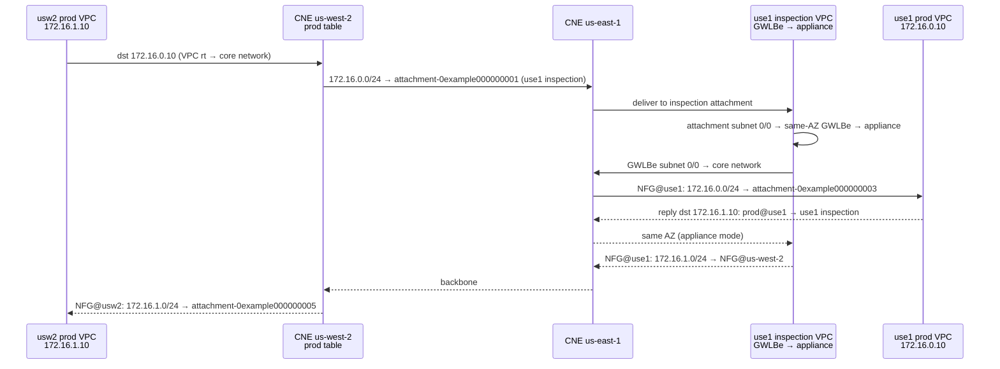

# Cloud WAN policy analysis: traffic handling

> **Reference deployment.** This analysis was made against a live deployment of this repo with the default inputs and the example `terraform.tfvars` (two regions, `prod` and `dev`, `egress_inspection = true`, DNS forwarding on).
> - All IDs are placeholders, with the same mapping as [`ARCHITECTURE.md`](ARCHITECTURE.md): `core-network-0example000000001`, `attachment-0example00000000N`, `vpc-0example00000000N`.
> - The CIDRs are the example ones.

**Policy:** version **4**, alias `LIVE, LATEST`, state `EXECUTION_SUCCEEDED`.

## 1. Source and provenance

How to get the policy and the evidence used below. Every call is read-only.

```sh
aws networkmanager get-core-network-policy \
  --core-network-id <core-network-id>          # live policy
aws networkmanager get-network-routes \
  --global-network-id <global-network-id> \
  --route-table-identifier 'CoreNetworkSegmentEdge={CoreNetworkId=<core-network-id>,SegmentName=<seg>,EdgeLocation=<region>}'
aws networkmanager get-network-routes ... \
  --route-table-identifier 'CoreNetworkNetworkFunctionGroup={CoreNetworkId=<core-network-id>,NetworkFunctionGroupName=inspection,EdgeLocation=<region>}'
```

**Drift check:** compare the live document, as sorted-key JSON, with `data.aws_networkmanager_core_network_policy_document.core_policy` in Terraform state. In the reference deployment they were identical, so Terraform and AWS agreed.

**Version history of the reference deployment:**

| Ver | Segments isolated | Segment actions | Notes |
|---|---|---|---|
| 1 | no | `send-via` **dual-hop**, dev ↔ prod | Inter-segment inspection only. No egress. |
| 2 | no | `send-via` single-hop dev ↔ prod; `send-to` dev, prod | **Centralized** egress and inspection: edge overrides forced both through us-west-2 |
| 3 | no | as v2, but **no edge overrides** | **Regional** egress |
| **4** | **yes** | v3 + `send-via` dev ↔ dev and prod ↔ prod | Intra-segment traffic is inspected too. Change set: 4 × `CORE_NETWORK_SEGMENT` MODIFY + `SEGMENTS_CONFIGURATION` MODIFY |

## 2. Core network configuration

| Setting | Value | Implication |
|---|---|---|
| `asn-ranges` | `64512-64555` | Private 2-byte ASN pool for the core network edges (CNEs) |
| `edge-locations` | us-east-1 (64512), us-west-2 (64513) | Two CNEs, with full-mesh connectivity over the AWS backbone |
| `dns-support` | `true` | Private DNS names resolve across attachments, for VPCs that enable it |
| `security-group-referencing-support` | `false` | Security groups **can't** reference security groups in other attached VPCs, so cross-VPC rules must use CIDRs |
| `vpn-ecmp-support` | `false` | Not relevant: there are no VPN or Connect attachments |
| `version` | `2021.12` | The only policy schema version |

## 3. Segments

| Segment | `isolate-attachments` | `require-attachment-acceptance` | Members (attachment / VPC) |
|---|---|---|---|
| `dev` | `true` | `false` | `attachment-0example000000004` (use1, `vpc-0example000000002`), `attachment-0example000000006` (usw2, `vpc-0example000000005`) |
| `prod` | `true` | `false` | `attachment-0example000000003` (use1, `vpc-0example000000001`), `attachment-0example000000005` (usw2, `vpc-0example000000004`) |

- **`isolate-attachments: true`:** attachments in a segment don't propagate routes to each other, so by default two VPCs in the same segment can't reach each other. The only reachability within a segment comes from the same-segment `send-via` (§6). As a result, nothing in either segment table points directly at a workload attachment.
- **`require-attachment-acceptance: false`:** any attachment whose tags match an attachment policy joins the segment automatically, with no review. See the risks in §9.

## 4. Network Function Group

| NFG | `require-attachment-acceptance` | Members |
|---|---|---|
| `inspection` | `false` | `attachment-0example000000001` (use1, `vpc-0example000000003`), `attachment-0example000000002` (usw2, `vpc-0example000000006`) |

- An NFG is a set of inspection attachments that Cloud WAN manages. Its route tables are populated **only** by segment actions. The NFG tables (§7.2) contain exactly the workload CIDRs, so this is the "return" side of inspection.
- The inspection VPC CIDRs (172.16.20.0/24 and 172.16.21.0/24) appear in **no** segment table. Workloads can't route to the appliance subnets over Cloud WAN, which isolates appliance management from workloads.
- Each inspection VPC routes its attachment subnets to a same-AZ GWLB endpoint: `0/0 → GWLBe`, then GWLBe subnets `0/0 → core network`. Appliance mode is on in the attachments, which keeps both directions of a flow in one AZ.

## 5. Attachment policies

Rules are evaluated in ascending `rule-number` order, and the first match wins. All rules use tag matching (`tag-value`, `equals`).

| Rule | Condition | Action |
|---|---|---|
| 100 | tag `Segment = dev` | associate with segment `dev` (`constant`) |
| 200 | tag `Segment = prod` | associate with segment `prod` (`constant`) |
| 1000 | tag `NetworkFunctionGroup = inspection` | add to NFG `inspection` |

- The tags are generated in `locals.tf` from the same names the policy uses. No tags are hardcoded.
- **Untagged or mis-tagged attachments** match no rule. Such an attachment isn't associated with any segment or NFG, so it gets no routes and nothing routes to it.
- **Conflicting tags:** an attachment tagged both `Segment=prod` and `NetworkFunctionGroup=inspection` matches rule 200 first and lands in `prod`, not the NFG.
- The rule numbers are spaced (100, 200, …, 1000), so a new segment fits in without renumbering. Terraform assigns 100 × the segment's position in the sorted segment keys, so adding a segment that sorts earlier **renumbers** the existing rules. That's harmless, but it is a policy change.

## 6. Segment actions

### 6.1 `send-via` (east-west inspection)

| # | Segment | `when-sent-to` | Mode | Via | Pairs covered |
|---|---|---|---|---|---|
| 1 | `dev` | `prod`, `dev` | single-hop | `inspection` | dev ↔ prod, dev ↔ dev |
| 2 | `prod` | `prod` | single-hop | `inspection` | prod ↔ prod |

- **Bidirectional.** `send-via` installs routes in **both** segments of a pair, so each unordered pair needs only one rule. Terraform emits, for each segment, itself plus the segments after it in sorted order. That's why `dev` lists `[prod, dev]` and `prod` lists only `[prod]`. Together the rules cover all 3 pairs, with no duplicates.
- **Same-segment pairs** (dev ↔ dev, prod ↔ prod) are the only path between members of an isolated segment, so all intra-segment traffic between VPCs is inspected.
- **Single-hop** means each flow crosses exactly **one** inspection attachment:
  - Within a region, traffic is inspected in that region.
  - Across regions, there are no `with-edge-overrides`, so Cloud WAN picks one region per edge pair. In the reference deployment the route tables showed that it picked **us-east-1** for the use1 ↔ usw2 pair, in both directions and for both segments (§7.1). The us-west-2 appliance inspects only traffic between us-west-2 VPCs, plus us-west-2 egress.
- **Why not dual-hop:** v1 used dual-hop, which inspects in both the source and destination regions. Cloud WAN rejects an NFG that is used by both a dual-hop `send-via` and a `send-to` (`NETWORK_FUNCTION_GROUP_EXCLUSIVITY_VIOLATION`). Regional egress (`send-to`) therefore forces single-hop.

### 6.2 `send-to` (north-south egress)

| # | Segment | Via | Edge overrides |
|---|---|---|---|
| 3 | `dev` | `inspection` | none |
| 4 | `prod` | `inspection` | none |

- Installs static default routes in every segment, at every edge, pointing at the **local** inspection attachment. With no overrides, each region egresses through its own inspection VPC.
- Installs **both** `0.0.0.0/0` and `::/0`. The VPCs have no IPv6, so the IPv6 default is inert for now. It would take effect as soon as IPv6 is added.
- The inspection VPC has no IGW or NAT. The GWLB appliance (e.g. Zscaler Cloud Connector / ZTGW) carries egress to the internet itself, and return traffic comes back through the appliance and its GWLBe into Cloud WAN.
- To use these routes, each workload VPC's route table sends `0.0.0.0/0 → core network` (`cloudwan_destination_cidr`).

## 7. Effective routes (what v4 actually installed)

Attachment IDs: use1 inspection = `attachment-0example000000001`, usw2 inspection = `attachment-0example000000002`.

### 7.1 Segment route tables (all routes are `ACTIVE`)

| Destination | dev @ us-east-1 | prod @ us-east-1 | dev @ us-west-2 | prod @ us-west-2 | Type |
|---|---|---|---|---|---|
| `0.0.0.0/0`, `::/0` | use1 inspection | use1 inspection | **usw2 inspection** | **usw2 inspection** | STATIC (`send-to`) |
| 172.16.0.0/24 (use1 prod) | use1 inspection | use1 inspection | **use1 inspection** | **use1 inspection** | PROPAGATED (`send-via`) |
| 172.16.10.0/24 (use1 dev) | use1 inspection | use1 inspection | **use1 inspection** | **use1 inspection** | PROPAGATED |
| 172.16.1.0/24 (usw2 prod) | **use1 inspection** | **use1 inspection** | usw2 inspection | usw2 inspection | PROPAGATED |
| 172.16.11.0/24 (usw2 dev) | **use1 inspection** | **use1 inspection** | usw2 inspection | usw2 inspection | PROPAGATED |

Every destination, including the segment's own CIDRs, points at an inspection attachment. There are no direct workload-to-workload routes, which is the effect of isolation plus same-segment `send-via`. Within a VPC, the VPC's `local` route still takes precedence, so traffic within one VPC never reaches Cloud WAN.

### 7.2 NFG `inspection` route tables (where traffic goes after inspection)

| Destination | inspection @ us-east-1 | inspection @ us-west-2 |
|---|---|---|
| 172.16.0.0/24 (use1 prod) | `attachment-0example000000003` (use1 prod) | NFG @ us-east-1 |
| 172.16.10.0/24 (use1 dev) | `attachment-0example000000004` (use1 dev) | NFG @ us-east-1 |
| 172.16.1.0/24 (usw2 prod) | NFG @ **us-west-2** → usw2 prod | `attachment-0example000000005` (usw2 prod) |
| 172.16.11.0/24 (usw2 dev) | NFG @ **us-west-2** → usw2 dev | `attachment-0example000000006` (usw2 dev) |

- After inspection, traffic is delivered to local destinations directly, and to remote destinations through the remote CNE's NFG table.
- The NFG tables have **no default route**. Traffic the appliance sends back into Cloud WAN for an unknown destination is dropped. Internet egress never re-enters Cloud WAN, because the appliance sends it out itself.
- The NFG @ us-west-2 entries towards us-east-1 are present but unused in steady state, because cross-region flows are inspected in us-east-1.

## 8. Traffic-flow matrix

| Traffic class | Example | Forward path | Inspected | Verified in the reference deployment |
|---|---|---|---|---|
| Same VPC | instance ↔ instance in one VPC | VPC `local` route; never reaches Cloud WAN | **No** | n/a |
| Intra-segment, intra-region (two VPCs) | (no such pair in the example) | segment → local inspection → NFG → peer attachment | Once, locally | Not testable: one VPC per segment per region |
| Intra-segment, cross-region | usw2 prod ↔ use1 prod | usw2 prod → prod@usw2 → **use1 inspection** → NFG@use1 → use1 prod | Once, **us-east-1** | ✅ ICMP and SSH, both directions |
| Inter-segment, intra-region | usw2 prod ↔ usw2 dev | prod@usw2 → usw2 inspection → NFG@usw2 → usw2 dev | Once, in that region | ✅ in both regions |
| Inter-segment, cross-region | usw2 prod ↔ use1 dev | prod@usw2 → **use1 inspection** → NFG@use1 → use1 dev | Once, **us-east-1** | ✅ both directions, both pairs |
| Internet egress | any workload → internet | segment `0/0` → **local** inspection → GWLBe → appliance → internet | Local region | ✅ HTTP/HTTPS 200 and ICMP 8.8.8.8 from all 4 instances |
| DNS conditional forwarding (when `dns_forwarding` is set) | resolver endpoint ENI → provider DNS IP | resolver subnet `0/0` → segment `0/0` (send-to) → **local** inspection → GWLBe → appliance | Local region | ✅ targets answer udp/tcp 53 from all 4 VPCs (not reachable from the internet); a forwarded domain returns NXDOMAIN until it's configured on the provider side |
| Inbound from internet | internet → workload | No path: no IGW anywhere, and the NFG has no route in from outside. Only return traffic of sessions the appliance carries out. | n/a | n/a |
| To appliance subnets | workload → 172.16.2x.0/24 | No route in any segment table | n/a | n/a |

The return path of every flow is symmetric through the same inspection attachment. Example for usw2 prod ↔ use1 prod: on the return, prod@use1 `172.16.1.0/24 → use1 inspection`, then NFG@use1 → NFG@usw2 → usw2 prod. Within the inspection VPC, appliance mode keeps both directions on the same AZ's GWLBe and appliance.

### Representative flow (cross-region, intra-segment)



## 9. Risks, gaps and recommendations

| # | Finding | Impact | Recommendation |
|---|---|---|---|
| 1 | **Fail-closed on the appliance.** Every route except a VPC's `local` route points at inspection. | If the us-east-1 appliance or GWLBe fails, **all cross-region traffic** (both segments) and all us-east-1 traffic is black-holed. If us-west-2 fails, us-west-2 local traffic and egress are black-holed. | Monitoring and alarms on GWLBe/GWLB health and the Cloud WAN attachment metrics. Document fail-closed as intended behaviour. |
| 2 | **The single-hop region choice is implicit.** With no `with-edge-overrides`, Cloud WAN chose us-east-1 for every cross-region pair. | us-east-1 carries all cross-region load. The appliance policy in us-east-1 must allow us-west-2 source networks. A future change to the core network, such as adding an edge, could move the choice without any change to this repo. | Pin it explicitly with `with-edge-overrides` on `send-via`, e.g. `edge-sets [[us-east-1, us-west-2]] → use-edge-location`. Edge overrides are allowed with single-hop and `send-to`. |
| 3 | **Auto-acceptance, with membership driven by tags** (`require-attachment-acceptance: false` on both segments **and the NFG**). | Anyone who can create an attachment to this core network, in this account or via a RAM share, can join `prod` by tagging it. Worse, tagging an attachment `NetworkFunctionGroup=inspection` **adds it to the inspection NFG**, so it becomes a potential inspection target and could bypass or intercept traffic. | Set `require-attachment-acceptance = true` at least on the NFG (and on `prod`). Restrict `networkmanager:CreateVpcAttachment` and `TagResource` with IAM/SCP. |
| 4 | **No inspection exemptions.** Same-segment traffic is inspected too. | The appliance must explicitly allow intra-segment flows. It also adds latency and cost to traffic that may not need inspection. | Intended by design. Keep the appliance policy aligned with it. If inspection should be skipped for some flows, set `isolate-attachments = false` on that segment and drop its same-segment `send-via`. |
| 5 | **`::/0` is installed by `send-to`.** | Inert today. Once IPv6 is enabled in any VPC, IPv6 egress goes to the appliance, which may not handle it. | Confirm the appliance supports IPv6 before enabling it. |
| 6 | **Egress has no failover between regions.** | If a region's appliance fails, that region has no internet egress. | Optionally add a secondary path with `send-to` edge overrides. That would bring back centralized-egress semantics, as in v2, and needs a design decision. |
| 7 | **Security-group referencing is off.** | Cross-VPC security group rules must use CIDRs. | Enable it if referencing groups across VPCs is wanted. It must also be enabled per attachment. |
| 8 | **Policy-change blast radius.** Any segment-action change re-propagates routes for every segment and edge (v4 changed all 4 segment/edge tables at once). | A bad policy can black-hole everything at once. Terraform reports only "Incorrect policy". | Review the rendered JSON before applying (see [`CLAUDE.md`](../CLAUDE.md)). Pre-validate with `put-core-network-policy --cli-error-format json`, and keep the previous version ID handy for `restore-core-network-policy-version`. |

## 10. Summary

- Policy v4 creates a **fully inspected, fail-closed** network:
  - workload segments with isolated attachments
  - all east-west traffic, including traffic within a segment, forced through the `inspection` NFG with single-hop `send-via`
  - north-south traffic leaves through each region's own inspection VPC, via `send-to` without edge overrides.
- In the reference deployment the live policy matched Terraform.
- The installed routes match the intent, and Cloud WAN inspected all cross-region flows in **us-east-1**.
- Every traffic class that could be tested passed.
- The main open items: pin the cross-region inspection region explicitly (§9 #2), and require acceptance for NFG and segment attachments (§9 #3).
